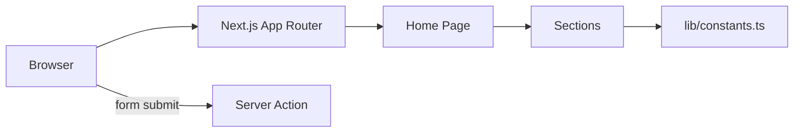

# Consultancy Wala

**Smart Solutions. Stronger Businesses.**

Marketing website for Consultancy Wala — an e-commerce growth agency helping brands launch, scale and dominate Amazon, Flipkart, Meesho and beyond.

[](https://nextjs.org)
[](https://react.dev)
[](https://www.typescriptlang.org)
[](https://tailwindcss.com)

## Overview

Consultancy Wala is a single-page marketing site plus legal pages for an Indian e-commerce growth agency. It presents services (marketplace onboarding, cataloging, PPC, account management, logistics, brand protection, website development, analytics), an about section, testimonials, FAQ, and a contact form. Leads are captured via a validated contact form (server-side) and WhatsApp deep links.

- **Audience:** prospective sellers/brands, existing clients, search engines.
- **Type:** frontend-only Next.js 16 (App Router) app. No database, no auth.

## Screenshots / Demo

> **Placeholder — no screenshots are committed in this repository yet.**
> To add them: capture the home page (desktop + mobile), the services section, and the
> contact form, save the images into `public/` (e.g. `public/screenshots/home.png`), and
> replace this block with Markdown image links:
>
> ```markdown
> 
> ```
>
> A live demo URL can be added here once the production deployment is confirmed.

## Features

**Core**
- Responsive, animated marketing site (hero, services, about, testimonials, FAQ, contact).
- Mobile navigation menu.
- Contact form with server-side validation, honeypot spam trap, field-level limits, and progressive enhancement (React 19 `useActionState`).
- Email delivery of enquiries via Resend (requires `RESEND_API_KEY`).
- WhatsApp deep links and floating chat bubble, with a pre-filled follow-up message after submission.

**Technical**
- SEO: metadata, Open Graph/Twitter cards, JSON-LD (Organization, WebSite, FAQPage) schema.
- Generated `sitemap.xml`, `robots.txt`, PWA manifest, OG image.
- Branded 404 and error boundary pages.
- Legal pages (Privacy Policy, Terms of Service) with shared shell.
- Accessible mobile menu (Escape to close, focus management, scroll lock) and FAQ accordion (aria-controls, region, crawlable answers).

**Security**
- CSP, HSTS, X-Content-Type-Options, X-Frame-Options, Referrer-Policy, Permissions-Policy, COOP headers.
- `poweredByHeader: false`.
- Server-side validation with control-character stripping and field limits.
- PII masking in server logs.
- `rel="noopener noreferrer"` on external links.

## Technology Stack

| Category | Technology |
|----------|------------|
| Framework | Next.js 16.3.5 (App Router) |
| UI | React 19.2.8, Tailwind CSS 4 |
| Language | TypeScript 5 (strict) |
| Animation | Framer Motion 13 |
| Icons | lucide-react |
| Utilities | clsx, tailwind-merge |
| Email | Resend (`resend ^4.0.0`) |
| Fonts | Plus Jakarta Sans (next/font/google) |
| Package manager | npm |

See [docs/02-technology-stack.md](docs/02-technology-stack.md).

## Technology Stack (details)

Additional dependencies vs. the original site: **Resend** (`resend ^4.0.0`) for email delivery, plus a new `lib/validation.ts` module (pure, testable field limits, sanitising, phone normalisation, PII masking).

## Architecture Overview

Static-first server-rendered site. Content is centralized in `lib/constants.ts`; a single Server Action (`actions/contact.ts`) validates and logs contact submissions. No database or authentication.



Details: [docs/04-system-architecture.md](docs/04-system-architecture.md).

## Project Structure

```
app/          # Routes, layouts, metadata routes, global styles
actions/      # Server Actions
components/   # UI, sections, primitives
lib/          # constants (content), validation, utils (cn)
public/       # Static assets (currently empty)
scripts/      # Maintenance tooling (docs validation)
.github/      # CI workflow (quality gates + opt-in Vercel deploy)
docs/         # Documentation
```

Full tree: [docs/03-project-structure.md](docs/03-project-structure.md).

## Prerequisites

- Node.js (version not pinned; use a version supported by Next.js 16).
- npm.

## Installation and Setup

```bash
git clone https://github.com/adityapandey2002/CW.git
cd CW
npm install
# optional: copy .env.example to .env.local and fill in values
npm run dev
```

Open http://localhost:3000.

Database/migrations not applicable. See [docs/11-installation-and-setup.md](docs/11-installation-and-setup.md).

## Environment Variables

| Variable | Required | Purpose | Default |
|----------|----------|---------|---------|
| `NEXT_PUBLIC_SITE_URL` | No | Production URL for sitemap/robots/manifest/metadata | `https://consultancywala.com` |
| `RESEND_API_KEY` | Yes (for email) | Resend API key used to send enquiries | — |
| `RESEND_FROM_EMAIL` | No | Verified sender address for enquiry emails | Resend sandbox sender |

See [`.env.example`](.env.example). Never commit real secrets; `.env*` is gitignored. See [docs/10-configuration-and-environment.md](docs/10-configuration-and-environment.md).

## Running the Application

```bash
npm run dev      # development
npm run build    # production build (TS check)
npm run start    # production server
npm run lint     # ESLint
```

## API Documentation

No REST/GraphQL API. Single Server Action `submitContact`. See [docs/08-api-documentation.md](docs/08-api-documentation.md).

## Database

None. See [docs/07-database-documentation.md](docs/07-database-documentation.md).

## Testing

No automated test suite exists. Quality gates:

```bash
npm run lint                     # ESLint — passes
npx tsc --noEmit                 # type check — passes
npm run build                    # production build — passes (9 static routes)
node scripts/validate-docs.mjs  # docs links/fences/Mermaid — passes
```

See [docs/13-testing-and-quality.md](docs/13-testing-and-quality.md).

## Continuous Integration

[`.github/workflows/ci.yml`](.github/workflows/ci.yml) runs on every push and pull request to `main`:

1. `npm ci`
2. `npm run lint`
3. `npx tsc --noEmit`
4. `node scripts/validate-docs.mjs`
5. `npm run build`
6. `npm audit --audit-level=high` (advisory, non-blocking)

An opt-in Vercel production deploy job runs after the quality job when `VERCEL_DEPLOY_ENABLED` is set to `true` and the `VERCEL_TOKEN`, `VERCEL_ORG_ID`, `VERCEL_PROJECT_ID` secrets exist. Setup: [docs/14-deployment-and-infrastructure.md](docs/14-deployment-and-infrastructure.md).

## Deployment

```bash
npx vercel
```

Set `NEXT_PUBLIC_SITE_URL` before deploying. See [docs/14-deployment-and-infrastructure.md](docs/14-deployment-and-infrastructure.md).

## Known Gaps

Remaining items that need human decisions or external services:

- No automated test suite (no Jest/Vitest/Playwright); lint + typecheck + build are the quality gates.
- No `LICENSE` file.
- Email delivery requires `RESEND_API_KEY` (and a verified domain for non-test recipients); configured per environment.
- No rate limiting at the network edge (honeypot is in place).
- The Vercel deploy job is opt-in and skipped until its repository variable and secrets are configured.

## Documentation

Full documentation index: [docs/README.md](docs/README.md)

| Document | Topic |
|----------|-------|
| [01-project-overview.md](docs/01-project-overview.md) | What the project is and who it serves |
| [02-technology-stack.md](docs/02-technology-stack.md) | Languages, frameworks, libraries |
| [03-project-structure.md](docs/03-project-structure.md) | Directory tree and module layout |
| [04-system-architecture.md](docs/04-system-architecture.md) | Architecture, layers, data flow |
| [05-application-workflows.md](docs/05-application-workflows.md) | End-to-end workflows |
| [06-modules-and-features.md](docs/06-modules-and-features.md) | Module-by-module analysis |
| [07-database-documentation.md](docs/07-database-documentation.md) | Database (none used) |
| [08-api-documentation.md](docs/08-api-documentation.md) | Server Action and HTTP surface |
| [09-authentication-and-authorization.md](docs/09-authentication-and-authorization.md) | Auth (none implemented) |
| [10-configuration-and-environment.md](docs/10-configuration-and-environment.md) | Configuration and env vars |
| [11-installation-and-setup.md](docs/11-installation-and-setup.md) | Local setup |
| [12-development-guide.md](docs/12-development-guide.md) | Developer workflow and conventions |
| [13-testing-and-quality.md](docs/13-testing-and-quality.md) | Testing and linting |
| [14-deployment-and-infrastructure.md](docs/14-deployment-and-infrastructure.md) | Deployment |
| [15-security-documentation.md](docs/15-security-documentation.md) | Security posture |
| [16-error-handling-and-logging.md](docs/16-error-handling-and-logging.md) | Errors and logs |
| [17-integrations-and-third-party-services.md](docs/17-integrations-and-third-party-services.md) | External integrations |
| [18-maintenance-and-troubleshooting.md](docs/18-maintenance-and-troubleshooting.md) | Maintenance and troubleshooting |
| [19-performance-and-scalability.md](docs/19-performance-and-scalability.md) | Performance and scaling |
| [20-future-improvements.md](docs/20-future-improvements.md) | Future improvements |
| [AI_AGENT_CONTEXT.md](docs/AI_AGENT_CONTEXT.md) | Context for AI coding agents |
| [diagrams/](docs/diagrams/system-architecture.md) | Mermaid diagrams |

Validate the docs (links, code fences, Mermaid) with:

```bash
node scripts/validate-docs.mjs
```

## Contributing

Proposed guidelines (no existing CONTRIBUTING.md):
1. Keep changes focused; follow existing TypeScript/Tailwind conventions.
2. Edit site content in `lib/constants.ts`.
3. Run `npm run lint` and `npm run build` before committing.
4. Do not commit secrets or `.env*` files.

## License

No `LICENSE` file present in the repository. License not yet specified.

## Acknowledgements

Built with Next.js, React, Tailwind CSS, Framer Motion, lucide-react.

## Contact and Support

- Phone: +91 8601862114
- Email: adityapandey.adu@gmail.com
- Address: Kumhrar, Patna, Bihar 800026
- Repository: https://github.com/adityapandey2002/CW

## Project Status

Private project (`"private": true`), no release tags published. The site builds and runs successfully (`npm run lint`, `npm run build` verified).