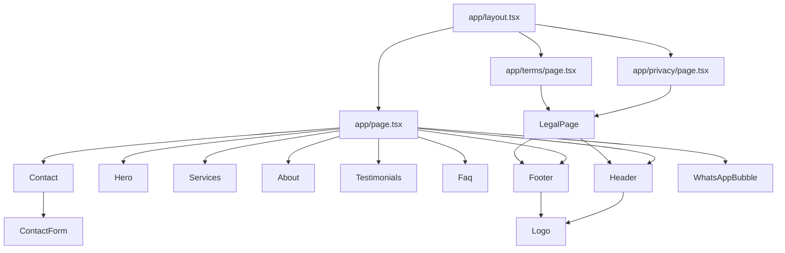
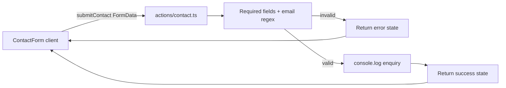

# 04 — System Architecture

## Architectural Pattern

**Static-first, server-rendered marketing site** built on Next.js 16 App Router. Most UI is rendered on the server (React Server Components); interactive parts are client components. There is no database, no authentication, and no separate backend service.

## Goals Implied by the Implementation

- Fast first paint and SEO-friendly HTML for a marketing site.
- Centralized content editing (`lib/constants.ts`).
- Low operational complexity (no DB, no auth, no background jobs).
- Lead capture without a backend CRM (contact Server Action + WhatsApp deep links).

## Layers

| Layer | Location | Responsibility |
|-------|----------|----------------|
| Presentation | `app/`, `components/` | Routes, layout, sections, UI primitives |
| Content/domain | `lib/constants.ts` | Site info, navigation, services, testimonials, FAQs, stats |
| Server logic | `actions/contact.ts` | Validate and accept contact submissions |
| SEO/metadata | `app/layout.tsx`, `app/robots.ts`, `app/sitemap.ts`, `app/manifest.ts`, `app/opengraph-image.tsx` | Metadata, sitemap, robots, manifest, OG image |
| Styling/design system | `app/globals.css`, `components/ui/` | Tokens, utilities, primitives |
| Error handling | `app/error.tsx`, `app/not-found.tsx` | Route-level error boundary and 404 |

## Frontend Architecture

### Rendering Strategy

- **Server Components by default:** `app/page.tsx`, sections, footer, legal pages.
- **Client Components:** `Header` (menu state), `ContactForm` (form state), `Faq` (accordion state), `Reveal` (motion), `WhatsAppBubble` (motion), `app/error.tsx` (client boundary).
- **No data fetching:** all data is imported constants; no `fetch`, no route handlers.

### Component Tree

### State Management

- Local React state only:
  - `Header`: `open` (mobile menu).
  - `ContactForm`: `pending`, `sent`, `error`.
  - `Faq`: `openIndex`.
- No Context, Redux, Zustand, or server cache.

### Design System

- Tailwind CSS v4 CSS-first tokens in `app/globals.css`:
  - Colors: `navy`, `brand-orange`, `brand-magenta`, `brand-purple`, `surface`, `muted-foreground`, `border`.
  - Font: `--font-jakarta` mapped to `--font-sans`.
  - Custom utilities: `bg-cta-gradient`, `gradient-text`, `bg-cta-gradient-soft`, `bg-grid`.
- `components/ui/*` primitives accept `className` and merge it via `cn()`.

## Backend Architecture

There is no server framework beyond Next.js. The only server-side mutation is the `submitContact` Server Action.

### Server Action Contract

- Input: `FormData` with `name`, `email`, `phone`, `businessName`, `service`, `message`.
- Output: `ContactFormState` (`idle | success | error` + optional message).
- Side effects: stdout log only.
- Email provider integration is an explicit TODO.

## Data Access Architecture

No database, ORM, repository layer, or caching layer. Content is static data imported at build time.

## Communication Between Components

- Parent → child props (e.g., `SectionHeading` title ReactNode, `Reveal` delay).
- Shared imports from `lib/constants.ts` and `lib/utils.ts`.
- Server Action RPC for the form.
- No event bus or external state.

## SEO Architecture

| Output | Source | Notes |
|--------|--------|-------|
| `<title>`/description/OG/Twitter | `app/layout.tsx` metadata | `metadataBase` from `SITE.url`; title template `%s \| Consultancy Wala` |
| Canonical | Per-route metadata: `app/page.tsx` (`/`), `app/privacy/page.tsx` (`/privacy`), `app/terms/page.tsx` (`/terms`) | Root layout intentionally declares none, so legal pages do not inherit `/` |
| JSON-LD Organization | `app/layout.tsx` inline script | Verified output: name, url, email, telephone, PostalAddress (Patna/Bihar/800026/IN), description |
| `robots.txt` | `app/robots.ts` | Verified output: `User-Agent: *`, `Allow: /`, `Host: consultancywala.com`, `Sitemap: https://consultancywala.com/sitemap.xml` |
| `sitemap.xml` | `app/sitemap.ts` | Verified output: 3 URLs (`/`, `/privacy`, `/terms`) with weekly/yearly frequencies and priorities 1 / 0.3 / 0.3 |
| PWA manifest | `app/manifest.ts` | Verified output: `name`, `short_name: "CW"`, standalone display, `#ffffff` colors, `/icon.svg` + `/favicon.ico` icons |
| OG image | `app/opengraph-image.tsx` | 1200×630 PNG via `next/og` (`image/png`) |

## Error Handling Strategy

- Expected validation errors are values, not exceptions.
- Route-level unexpected errors are caught by `app/error.tsx`; `retry()` re-renders.
- 404 via `app/not-found.tsx`.
- No global error reporting.

## Logging Strategy

- `console.log` for enquiries — structured object with PII masked (`maskEmail`, `maskPhone`) and `receivedAt`.
- `console.error` for email failures and route errors.
- No log aggregation or retention policy in code.

## Caching Strategy

- Content is static; pages are prerendered and served with a one-year shared-cache lifetime.
- `next.config.ts` carries security headers, not caching rules.
- No ISR, revalidation, or `dynamic` exports.

## Background Jobs / Real-Time

None.

## Third-Party Integrations

WhatsApp, Instagram, LinkedIn links; Google Fonts; intended Vercel hosting. See `17-integrations-and-third-party-services.md`.

## Architecture Constraints and Trade-offs

- **Pros:** minimal infrastructure, cheap to host, fast, simple to reason about.
- **Cons:** no lead persistence, no CMS, no auth, no tests. Content changes require a deploy.
- **Scalability:** trivial for static traffic; contact submissions are not stored, so no write scaling concerns.

## Known Architectural Issues

1. **Phone links are relative URLs (verified):** `SITE.phoneHref` is `"+918601862114"` and is used verbatim as `href`, so browsers resolve it as a path rather than a `tel:` URI. Fix: prefix with `tel:`.
2. **No test suite:** lint + typecheck + build are the only automated quality gates.
3. **No `LICENSE` file.**
4. **Dependency hygiene:** `npm audit` reports advisories in the dependency tree; keep Next.js 16 compatibility in mind when updating.

## Resolved by the Remote Revision

The repository has since been revised (origin/main) and now includes:
- Resend email delivery in `submitContact` (with honeypot, field limits, control-character stripping, PII masking in logs).
- `lib/validation.ts` — pure, testable validation helpers (`FIELD_LIMITS`, `sanitize`, `isValidPhone`, `normalizePhone`, `maskEmail`, `maskPhone`, `validateContactInput`).
- Security headers in `next.config.ts`: CSP, HSTS, X-Content-Type-Options, X-Frame-Options, Referrer-Policy, Permissions-Policy, COOP, plus `poweredByHeader: false`.
- Canonical moved from the root layout to `app/page.tsx`, so `/privacy` and `/terms` no longer inherit the home canonical.
- Richer JSON-LD (Organization/ProfessionalService, WebSite, FAQPage) with `<` escaping via `toJsonLd`.
- Accessible mobile menu (Escape, focus management, scroll lock) and FAQ accordion (aria-controls, role="region", crawlable answers).
- `CONTACT_SERVICE_OPTIONS` derived from `SERVICE_GROUPS`; `whatsappLink()` helper with `encodeURIComponent`.
- GitHub Actions CI workflow (lint, typecheck, docs validation, build, advisory audit, opt-in Vercel deploy).
- `PROJECT_CONTEXT.md` and `DEPLOYMENT_GUIDE.md` (additional, overlapping documentation).

See `diagrams/system-architecture.md` and `diagrams/application-flow.md`.