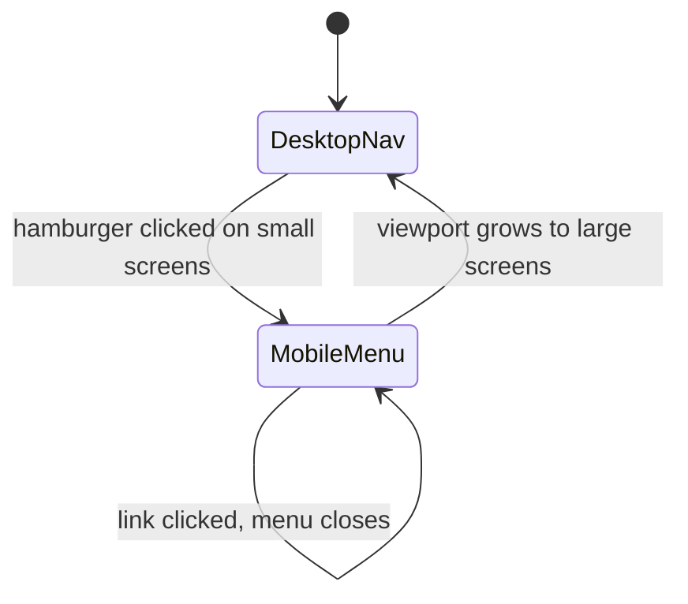

# 05 — Application Workflows

## 1. Visitor Loads the Home Page

1. Browser requests `GET /`.
2. Next.js renders `app/layout.tsx`: `Plus_Jakarta_Sans` font variable, viewport (`themeColor #ffffff`, `width=device-width`, `initialScale=1`), metadata (title template `%s | Consultancy Wala`, description, keywords, OG/Twitter cards, robots `index/follow`, icons), and the JSON-LD scripts.
3. `app/page.tsx` renders `Header`, the six sections, `Footer`, `WhatsAppBubble`.
4. Content comes from `lib/constants.ts` (`SITE`, `NAV_LINKS`, `SERVICE_GROUPS`, `STATS`, `TESTIMONIALS`, `FAQS`).
5. The browser hydrates only the client components: `Header`, `Reveal`, `Faq`, `ContactForm`, `WhatsAppBubble`, plus `app/error.tsx` if mounted.

## 2. Navigation Flow



- Anchors: `#home`, `#services`, `#about`, `#faq`, `#contact` (from `NAV_LINKS`).
- CSS `scroll-behavior: smooth` + `scroll-padding-top: 90px` aligns anchors below the 72px fixed header.
- `scroll-mt-20` on each section provides additional offset.
- Mobile menu toggles with `setOpen((v) => !v)`; `aria-expanded` and `aria-controls="mobile-menu"` reflect state.

## 3. Contact / Lead Submission

```mermaid
sequenceDiagram
  participant U as User
  participant F as ContactForm (client)
  participant A as submitContact (server action)
  participant L as stdout

  U->>F: Submit form
  F->>F: Browser constraint validation (required, type=email)
  F->>A: submitContact({status:"idle"}, FormData)
  A->>A: Trim + read 6 fields
  A->>A: Required check (name, email, phone, message)
  alt missing fields
    A-->>F: {status:"error", message}
    F-->>U: Inline alert (role="alert")
  else all present
    A->>A: EMAIL_REGEX test
    alt invalid email
      A-->>F: {status:"error", message}
      F-->>U: Inline alert
    else valid
      A->>L: console.log(payload + receivedAt)
      A-->>F: {status:"success", message}
      F->>F: form.reset(); setSent(true)
      F-->>U: "Message sent!" panel
    end
  end
```

Details:
- The form is a plain `<form>` with `onSubmit` prevented (`event.preventDefault()`), then `new FormData(form)`.
- `pending` disables the submit button and shows a spinner (`Loader2` with `animate-spin`).
- The success panel replaces the form and offers "Send another message" (resets `sent` to false).
- The WhatsApp link under the submit button is an alternative channel.
- **Not implemented:** email delivery, persistence, rate limiting.
- **Verified live:** an invalid email renders the inline alert "Please enter a valid email address."; a valid payload renders the "Message sent!" panel and writes the enquiry to stdout.

## 4. FAQ Accordion

- `openIndex` starts at `0` (first question open).
- Clicking a question sets `openIndex` to that index, or `null` if it was already open (so the item collapses).
- The answer panel animates height `0 → auto` with `AnimatePresence`; `useReducedMotion` disables the animation.
- **Verified live:** `aria-expanded` was `true,false,false,false,false` on load; clicking item 3 left only item 3 expanded.

## 5. WhatsApp Lead Flow

- CTAs across hero, header (mobile), contact section, form footer, footer socials, and the floating bubble open `SITE.whatsappHref` in a new tab with a pre-filled message.

## 6. Legal Pages

- `/privacy` and `/terms` render the `LegalPage` shell: Header, "Last updated" label, title, prose body, Footer.
- Each page exports its own `metadata` (title/description); the root layout's title template renders "Privacy Policy | Consultancy Wala".

## 7. Error Paths

| Trigger | Result |
|---------|--------|
| Unhandled error in a route segment | `app/error.tsx` renders; `console.error` logs it; "Try Again" calls `retry()` |
| Unknown URL | `app/not-found.tsx` renders branded 404 with Home / Contact links |
| Client action promise rejects | The Server Action catches email failures and returns an error state; `useActionState` clears `pending` |

## 8. SEO / Discovery Flow

| Artifact | Route | Generated when |
|----------|-------|-----------------|
| `robots.txt` | `/robots.txt` | Build/server request |
| `sitemap.xml` | `/sitemap.xml` | Build/server request (`lastModified` = generation time) |
| `manifest.webmanifest` | `/manifest.webmanifest` | Build/server request |
| OG image | `/opengraph-image` | Server request, rendered via `next/og` |
| Icons | `/icon.svg`, `/favicon.ico` | Static assets |

**Verified live** (production build, default `NEXT_PUBLIC_SITE_URL`):

```
GET /robots.txt            200 text/plain
User-Agent: *
Allow: /

Host: consultancywala.com
Sitemap: https://consultancywala.com/sitemap.xml
```

`sitemap.xml` returns three URLs (`/`, `/privacy`, `/terms`) with `changefreq` weekly/yearly/yearly and `priority` 1 / 0.3 / 0.3. The manifest returns `{"name":"Consultancy Wala","short_name":"CW", ...}` with `display: "standalone"` and both icon entries.

## 9. Content Editing Workflow

1. Edit `lib/constants.ts` (site info, nav, services, testimonials, FAQs, stats).
2. Optionally edit `app/privacy/page.tsx` / `app/terms/page.tsx`.
3. Run `npm run lint` and `npm run build`.
4. Deploy.

There is no CMS; every change requires a code change and a deploy.