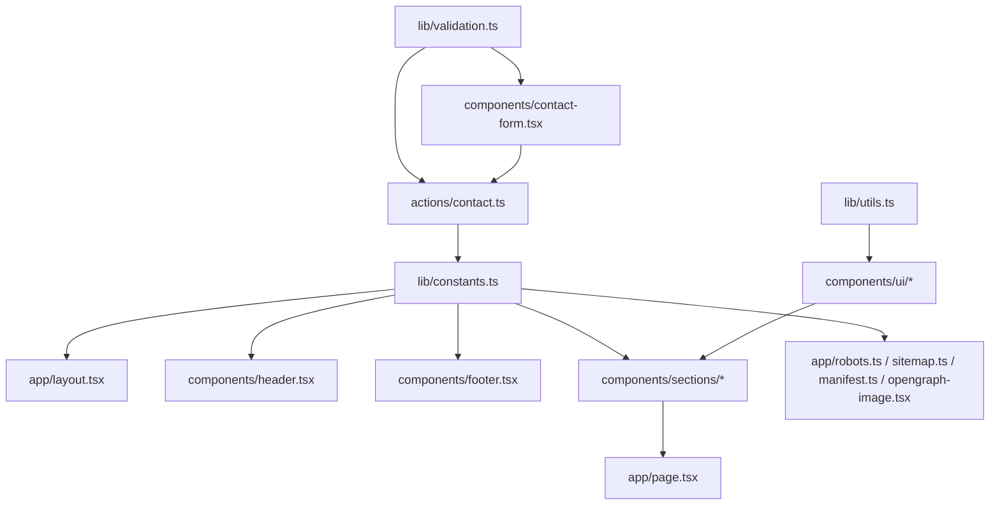

# 06 — Modules and Features

This document describes every meaningful module in the repository. The project is small; "modules" are source folders/components plus the content and action layers.

## Module Map

---

## 1. `lib/constants.ts` — Content and Domain Data

- **Purpose:** Single source of truth for site identity, navigation, services, testimonials, FAQs, and stats.
- **Exports:**
  - `SITE` (const object): name, taglines, hero, coFounder, URL, phone, phoneHref, whatsappHref, email, address, instagram, linkedin.
  - `NAV_LINKS` (const array): Home/Services/About/FAQ/Contact anchors.
  - `Service` / `ServiceGroup` types.
  - `SERVICE_GROUPS`: 4 groups, 10 services total.
  - `TESTIMONIALS`: 3 entries with quote/name/role/platform.
  - `FAQS`: 5 Q&A entries.
  - `STATS`: 4 metrics.
- **Dependencies:** `lucide-react` icons (`Store`, `Globe`, `PackageSearch`, `Target`, `TrendingUp`, `UserCog`, `Truck`, `ShieldCheck`, `Code2`, `BarChart3`).
- **Inputs:** `process.env.NEXT_PUBLIC_SITE_URL` for `SITE.url`.
- **Outputs:** Constants consumed across the app.
- **Business rules:**
  - Production URL default `https://consultancywala.com`.
  - WhatsApp link includes a pre-filled message: "Hi Consultancy Wala, I want to grow my e-commerce business."
- **Related APIs/DB:** None.
- **Care:** Changing `SITE.name`, `SITE.url`, or `SERVICE_GROUPS` affects metadata, footer, about, services, and generated routes.

## 2. `lib/validation.ts` — Contact Form Validation (pure, testable)

- **Purpose:** Authoritative, dependency-free validation helpers for the contact form.
- **Exports:** `FIELD_LIMITS`, `sanitize`, `digitsOnly`, `isValidPhone`, `normalizePhone`, `validateContactInput`, `maskEmail`, `maskPhone`, plus `ContactInput` / `ValidationResult` types.
- **Used by:** `actions/contact.ts` (server) and `components/contact-form.tsx` (client field limits via `maxLength`).
- **Key rules:**
  - Per-field length limits (name 100, email 254, phone 32, businessName 120, service 80, message 4000).
  - `sanitize()` strips control characters (`\u0000–\u001F`, `\u007F`) and collapses whitespace — header/log injection defence.
  - `isValidPhone()` accepts 10–15 digits; `normalizePhone()` rewrites 10-digit Indian numbers to `+91…`.
  - `validateContactInput()` returns `{ ok, data }` or `{ ok, message }`.
  - `maskEmail()` / `maskPhone()` reduce PII to fingerprints for logs.
- **Business rules:** over-long input is reported as an error (not silently truncated); email regex `/^[^\s@]+@[^\s@]+\.[^\s@]{2,}$/`.

## 3. `lib/utils.ts` — Class Merging

- **Purpose:** `cn(...inputs: ClassValue[]): string` using `clsx` + `tailwind-merge`.
- **Used by:** `Button`, `Card`, `Input`, `Label`, `Select`, `Textarea`, `Logo`, `SectionHeading`, `Faq`, `Header`.
- **Business rules:** Tailwind conflict resolution (later classes win where applicable).

## 4. `actions/contact.ts` — Contact Server Action

- **Directive:** `"use server"`.
- **Imports:** `Resend` from `resend`; `SITE` from `@/lib/constants`; `maskEmail`, `maskPhone`, `validateContactInput` from `@/lib/validation`.
- **Exports:** `ContactFormState` (`status`, `message?`, `fieldErrors?`), `submitContact`.
- **Input:** `_prevState: ContactFormState`, `formData: FormData`.
- **Processing:**
  1. **Honeypot:** if `company_website` is non-empty, return success without sending email (bot signal suppressed).
  2. Extract six fields from `FormData`.
  3. `validateContactInput(raw)` — sanitise, length limits, required checks, email regex, phone normalisation.
  4. On validation failure, return `{ status: "error", message }`.
  5. Send email via Resend: `from` = `RESEND_FROM_EMAIL` (default sandbox sender), `to` = `SITE.email`, `replyTo` = submitter, subject `New enquiry from <name>`, body with all fields.
  6. Check Resend's `{ error }` explicitly (Resend resolves rather than throws).
  7. Log metadata only, with PII masked (`maskEmail`, `maskPhone`) plus `receivedAt`.
  8. On any failure, log to `console.error` and return a generic error message (configuration state is never leaked).
- **Outputs:** `{ status: "success" | "error", message? }`.
- **Side effects:** email send (if configured) + masked stdout log.
- **Error handling:** validation errors returned as values; runtime failures caught and converted to a generic error state.
- **Business rules:** business name/service optional; required fields name/email/phone/message; honeypot returns fake success.
- **Known gap:** no rate limiting at the network edge; no CAPTCHA beyond the honeypot.

## 5. UI Primitives (`components/ui/`)

### `button.tsx`
- Exports `buttonVariants(args)`, `Button`, `ButtonLink`.
- Variants: `primary`, `outline`, `ghost`, `light`; sizes `sm`, `md`, `lg`.
- Base styles include focus-visible outline, active scale, disabled state.
- `ButtonLink` renders an `<a>` for navigation/CTAs.

### `card.tsx`
- `Card` wraps a `div` with rounded border, white background, shadow.

### `input.tsx`, `label.tsx`, `select.tsx`, `textarea.tsx`
- Focus rings, border tokens, surface background.
- `Select` adds a `ChevronDown` icon overlay.
- All forward native HTML attributes via `...props`.

## 6. `components/header.tsx` — Navigation

- **Client component** (`"use client"`).
- **State:** `open` for mobile menu; refs for toggle/panel.
- **Data:** `NAV_LINKS`, `SITE`, `Logo`, `ButtonLink`, `buttonVariants`.
- **Behavior:**
  - Fixed header with blur background.
  - Desktop nav shown at `lg`; phone link + "Get Free Audit".
  - Mobile hamburger toggles menu; links close menu.
  - Mobile menu includes WhatsApp CTA and phone.
  - Escape closes the menu and returns focus to the toggle.
  - Body scroll is locked while the menu is open.
  - Focus moves into the panel on open.
- **Accessibility:** `aria-expanded`, `aria-controls`, `aria-label` on toggle; nav landmarks; `aria-label` on both navs.

## 7. `components/footer.tsx` — Footer

- **Server component.**
- **Data:** `SITE`, `NAV_LINKS`, `SERVICE_GROUPS` (first 6 services), social icons, legal links.
- **Behavior:** brand/description/socials, explore links, services links, contact (phone/email/address), copyright with current year, legal links, "Made with ♥ in Patna".
- **Business rules:** service links all point to `#services`; legal links to `/privacy`, `/terms`.

## 8. `components/logo.tsx` — Brand Mark

- **Props:** `variant?: "dark" | "light"`, `className?`.
- Renders "CW" gradient tile + wordmark + tagline; links to `#home`.
- **Note:** On legal pages, `#home` anchor does not exist; link behavior depends on browser (navigates to same page with hash). This is a minor UX issue.

## 9. `components/reveal.tsx` — Scroll Animation Wrapper

- **Client component.**
- **Props:** `children`, `className?`, `delay?`.
- Uses `useReducedMotion`; if reduced, no initial/whileInView animation.
- `viewport={{ once: true, margin: "-80px" }}`, duration 0.6s easeOut.

## 10. `components/section-heading.tsx` — Shared Heading

- **Props:** `eyebrow?`, `title: ReactNode`, `subtitle?`, `align?: "center" | "left"`.
- Wraps in `Reveal`; renders eyebrow pill, `h2`, subtitle.

## 11. `components/social-icons.tsx` — Inline SVGs

- Exports `WhatsAppIcon`, `InstagramIcon`, `LinkedInIcon`.
- Props: `className?`; SVG `aria-hidden="true"`; size default `h-5 w-5`.

## 12. `components/legal-page.tsx` — Legal Shell

- **Props:** `title`, `updated`, `children`.
- Renders Header, title, "Last updated", prose container (`.legal-prose`), Footer.

## 13. `components/contact-form.tsx` — Lead Form

- **Client component.**
- **State:** `useActionState(submitContact, INITIAL_STATE)` → `{ state, formAction, pending }`; plus `summary` for the WhatsApp follow-up.
- **Fields:** name*, phone*, email*, businessName, service (select), message*, plus hidden honeypot `company_website`.
- **Service options:** derived from `CONTACT_SERVICE_OPTIONS` (which is derived from `SERVICE_GROUPS` + "Something else") — no drift.
- **Field limits:** `maxLength` from `FIELD_LIMITS` (name 100, email 254, phone 32, businessName 120, service 80, message 4000).
- **Submit:** progressive enhancement via `action={formAction}`; `onSubmit` captures a summary for the WhatsApp deep link without preventing default.
- **Success state:** resets the form, shows "Message sent!", and offers "Send it again on WhatsApp" with a pre-filled message.
- **Error state:** inline alert in an `aria-live="polite"` region.
- **Accessibility:** labels, `required`, `aria-live`, disabled submit while pending, honeypot hidden with `aria-hidden` + `tabIndex={-1}`.

## 14. `components/whatsapp-bubble.tsx` — Floating CTA

- **Client component**; Framer Motion spring entrance, hover/tap scales, ping ring.
- Links to `SITE.whatsappHref` in new tab with `rel="noopener noreferrer"`.

## 15. Home Sections (`components/sections/`)

### `hero.tsx`
- Eyebrow, headline, description, two CTAs, stats grid from `STATS`.
- Decorative grid and blurred blobs; `Reveal` delays.

### `services.tsx`
- `SectionHeading` + grouped service cards.
- Each card: icon tile, title, description; hover lift.
- CTA "Not sure where to start? Get a free audit" → `#contact`.

### `about.tsx`
- Two-column: narrative + 4 pillars (Founder-Led, ROI-First, Transparent Pricing, Zero-to-Scale Ready).
- Uses `SITE.coFounder` and `SITE.taglineAlt`.

### `testimonials.tsx`
- 3 cards with quote, 5 stars, name/role/platform.
- Note: `<figcaption>` is rendered inside a `
` (the `Card` primitive) rather than inside a `<figure>` element, so the caption semantics do not apply as intended. A `<figure>` wrapper would be the conventional fix.

### `faq.tsx`
- Client accordion; first item open by default (`openIndex = 0`).
- Answers remain in the DOM (height 0 + overflow-hidden) so all of them are crawlable; only the open one is visible.
- `aria-expanded`, `aria-controls`, `aria-labelledby` on buttons; `role="region"` on answer panels.
- `AnimatePresence` removed in favour of animated height; `useReducedMotion` disables the transition.
- **Verified live:** `aria-expanded` was `true,false,false,false,false` on load; clicking item 3 left only item 3 expanded.

### `contact.tsx`
- Contact items (phone, WhatsApp, email), location card, response-time card, `ContactForm`.
- External links get `target="_blank"` + `rel` when href starts with `http`.

## 16. App Routes (`app/`)

### `layout.tsx`
- Root layout; `Plus_Jakarta_Sans`; viewport (theme color white, width, scale).
- Metadata: title template, description, keywords, OG, Twitter, robots, icons. (No canonical here — declared per-route in `app/page.tsx`.)
- JSON-LD: three schemas (ProfessionalService, WebSite, FAQPage) serialised with `<` escaped via `toJsonLd`.
- Renders `<html lang="en">` and body.

### `page.tsx`
- Home composition (Header, sections, Footer, WhatsAppBubble).

### `error.tsx`
- Client error boundary; logs error; "Try Again" calls `retry()`.

### `not-found.tsx`
- 404 with Header/Footer and home/contact links.

### `privacy/page.tsx`, `terms/page.tsx`
- Legal content; static metadata; uses `LegalPage`.
- Last updated: September 2026.

## 17. Metadata Routes

- `robots.ts`: allow `*`, sitemap `${SITE.url}/sitemap.xml`, host from `SITE.url`.
- `sitemap.ts`: home (weekly, priority 1), privacy/terms (yearly, priority 0.3), `lastModified` at generation.
- `manifest.ts`: name/short_name/description/start_url/display/colors/icons.
- `opengraph-image.tsx`: 1200×630 gradient image with brand name, hero, tagline, "Get a free audit".
- `icon.svg`, `favicon.ico`: static icons.

## 18. `app/globals.css` — Design Tokens

- `@import "tailwindcss"`.
- `:root` background/foreground/surface.
- `@theme inline` colors/font/animation/keyframes.
- Custom `@utility` classes.
- Smooth scrolling + reduced motion; body font; selection; `.legal-prose` typography.

## Feature Inventory

| Feature | Status | Evidence |
|---------|--------|----------|
| Single-page marketing site | Implemented | `app/page.tsx` |
| Responsive navigation (Escape, focus, scroll lock) | Implemented | `components/header.tsx` |
| Contact form server validation | Implemented | `actions/contact.ts`, `lib/validation.ts` |
| Email delivery of enquiries (Resend) | Implemented | `actions/contact.ts` |
| Honeypot spam trap | Implemented | `actions/contact.ts`, `components/contact-form.tsx` |
| Field-level limits + control-char stripping | Implemented | `lib/validation.ts` |
| PII masking in logs | Implemented | `lib/validation.ts` (`maskEmail`, `maskPhone`) |
| Progressive enhancement (useActionState) | Implemented | `components/contact-form.tsx` |
| WhatsApp follow-up after submission | Implemented | `components/contact-form.tsx` (`whatsappLink`) |
| WhatsApp CTAs | Implemented | `lib/constants.ts` (`whatsappLink()`) |
| Security headers (CSP, HSTS, etc.) | Implemented | `next.config.ts` |
| `poweredByHeader: false` | Implemented | `next.config.ts` |
| SEO metadata/JSON-LD (3 schemas) | Implemented | `app/layout.tsx` |
| Sitemap/robots/manifest/OG | Implemented | `app/*.ts(x)` |
| Legal pages | Implemented | `app/privacy`, `app/terms` |
| Per-route canonical (home) | Implemented | `app/page.tsx` |
| Error/404 pages | Implemented | `app/error.tsx`, `app/not-found.tsx` |
| Accessible mobile menu + FAQ accordion | Implemented | `components/header.tsx`, `components/sections/faq.tsx` |
| Lead persistence | Not implemented | no DB |
| Auth/admin | Not implemented | no auth code |
| Tests | Not implemented | no test files |
| CMS | Not implemented | hardcoded constants |
| CI/CD | Implemented | `.github/workflows/ci.yml` (quality gates + opt-in Vercel deploy) |