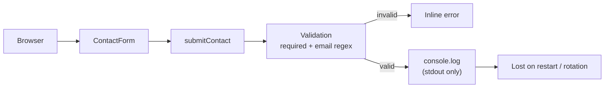

# 07 — Database Documentation

## Summary

**No database is used by this project.** There is no database engine, ORM, migration system, schema, seed script, or data client anywhere in the repository.

This is a deliberate architectural characteristic, not a gap in the documentation: the application is a public marketing site with no user accounts, no persisted content, and no queryable state.

## Evidence

| Check | Result |
|-------|--------|
| `package.json` dependencies | No database driver or ORM (no Prisma, Drizzle, Mongoose, Sequelize, TypeORM, `pg`, `mysql2`, `@vercel/postgres`, `better-sqlite3`, etc.) |
| Directories | No `prisma/`, `migrations/`, `models/`, `db/`, `seed/` directory |
| Schema files | No `.sql`, `.prisma`, or schema definition of any kind |
| Server actions | `actions/contact.ts` does not persist submissions; it only `console.log`s them |
| Content source | All site content is hardcoded in `lib/constants.ts` |
| Caching layer | No Redis, Memcached, or other cache client |

## Where Data Actually Lives

| Kind | Location | Lifecycle |
|------|----------|-----------|
| Site content (services, FAQs, testimonials, stats) | `lib/constants.ts` | Compiled into the bundle at build time; changes require a rebuild/deploy |
| Enquiries (name, email, phone, business name, service, message) | Process stdout | Written by `console.log`; retained only as long as the host keeps logs |
| Request/session state | None | No cookies, sessions, or tokens are issued |
| User accounts | None | No sign-up, login, or profile exists |

## Implications

- Contact form submissions are **not stored anywhere durable**. If the server restarts or log rotation removes them, the lead is lost.
- There is no historical record of enquiries, so no analytics, reporting, or follow-up automation is possible from application data.
- There is no user or account data, so there is no personal-data store to protect beyond the transient log line.
- Content changes require a code change and a deployment; there is no editorial workflow.

## Data Flow of a Contact Enquiry

## If Persistence Is Added Later

The natural insertion point is `actions/contact.ts`, immediately before the `console.log` call, replacing it with a write to a chosen store. Options, in rough order of effort:

1. **Transactional email** (e.g. Resend/Nodemailer) — the approach already sketched in the TODO comment in `actions/contact.ts`. No schema required.
2. **Form-to-CRM** — post to a third-party lead service. No schema required, no data residency concerns beyond the provider.
3. **Serverless KV / blob store** — a single JSON document per enquiry keyed by timestamp. Minimal schema.
4. **Relational database + ORM** — requires a new dependency, migrations, and a schema design.

> No schema is proposed here. The project currently has no database, and inventing one would misrepresent the codebase. A concrete schema belongs with the implementation work that introduces persistence.

## ER Diagram

No database entities exist, so there is no ER diagram to produce. See [`diagrams/database-er-diagram.md`](./diagrams/database-er-diagram.md), which states this explicitly and shows the in-code content model instead.

Related: [`20-future-improvements.md`](./20-future-improvements.md) (item 2, lead persistence) and [`17-integrations-and-third-party-services.md`](./17-integrations-and-third-party-services.md) (the email-provider TODO).