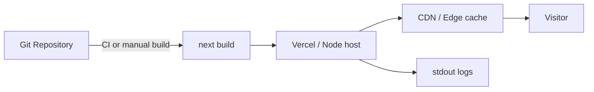

# 14 — Deployment and Infrastructure

## Supported Deployment Path (per README)

Vercel:

```bash
npx vercel
```

The README describes the site as "fully static-friendly".

## Build and Run

```bash
npm install        # or: npm ci  (reproducible, from package-lock.json)
npm run build     # production build (includes TypeScript check)
npm run start     # serve the production build locally
```

Verified locally: the build succeeds and prerenders 9 routes as static content.

```
Route (app)
┌ ○ /
├ ○ /_not-found
├ ○ /icon.svg
├ ○ /manifest.webmanifest
├ ○ /opengraph-image
├ ○ /privacy
├ ○ /robots.txt
├ ○ /sitemap.xml
└ ○ /terms

○  (Static)  prerendered as static content
```

## Required Configuration

| Setting | Purpose | Required? |
|---------|---------|-----------|
| `NEXT_PUBLIC_SITE_URL` | Correct URLs in sitemap/robots/manifest/metadata/OG | Effectively required for production on a non-default domain |

Set it as an environment variable in the hosting provider (e.g., Vercel Project Settings → Environment Variables), not in a committed file.

## Deployment Architecture



## Infrastructure as Code

None in the repository: no `vercel.json`, `Dockerfile`, `docker-compose.yml`, Kubernetes manifests, Terraform, or other IaC. Not verified.

## CI/CD

No CI configuration exists (no `.github/workflows`, `.gitlab-ci.yml`, etc.). Not verified.

## Runtime Requirements

- Node.js runtime supported by Next.js 16 (version not pinned in `package.json`).
- No database, cache, queue, or object storage provisioning required.
- No environment secrets other than the optional public site URL.

## Observability

Logs go to the host's stdout/stderr. No metrics, tracing, or alerting configured. Not verified.

## Operational Checklist

- [ ] `NEXT_PUBLIC_SITE_URL` set to the production domain.
- [ ] `npm run build` succeeds on the target platform (native SWC bindings available).
- [ ] `/sitemap.xml`, `/robots.txt`, and OG image resolve on the production domain.
- [ ] Contact form submits successfully in production (leads appear in host logs).
- [ ] Custom domain and HTTPS configured.
- [ ] Log retention for enquiries (PII) configured at the host level.

## Verified Behaviour (local production build)

| Check | Result |
|-------|--------|
| `GET /` | 200 `text/html` |
| `GET /privacy`, `GET /terms` | 200 `text/html` |
| `GET /robots.txt` | 200 `text/plain` — `Allow: /`, `Host`, `Sitemap` |
| `GET /sitemap.xml` | 200 `application/xml` — 3 URLs |
| `GET /manifest.webmanifest` | 200 `application/manifest+json` |
| `GET /opengraph-image` | 200 `image/png` |
| `GET /icon.svg`, `GET /favicon.ico` | 200 `image/svg+xml`, 200 `image/x-icon` |
| Unknown path | 404 |
| Contact form (valid) | "Message sent!" + stdout log line |
| Contact form (invalid email) | Inline "Please enter a valid email address." |