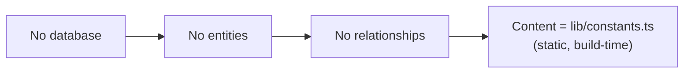

# Database ER Diagram

## Status: No Database

This project uses **no database**, so there are no entities, attributes, keys, indexes, or relationships to diagram.

Evidence:
- `package.json` contains no database driver or ORM.
- There is no `prisma/`, `drizzle/`, `migrations/`, `models/`, or `db/` directory.
- `actions/contact.ts` validates and logs submissions without persisting them.

## Content Model (in-code, not a database)

For reference, the "records" that exist are hardcoded TypeScript constants in `lib/constants.ts`:

| Constant | Shape | Approx. Size |
|----------|-------|--------------|
| `SITE` | Identity, contact, social links | 1 object |
| `NAV_LINKS` | `{ label, href }[]` | 5 entries |
| `SERVICE_GROUPS` | `ServiceGroup[]` (`title`, `subtitle`, `services[]`) | 4 groups / 10 services |
| `TESTIMONIALS` | `{ quote, name, role, platform }[]` | 3 entries |
| `FAQS` | `{ question, answer }[]` | 5 entries |
| `STATS` | `{ value, label }[]` | 4 entries |

See `docs/07-database-documentation.md` for the full analysis.