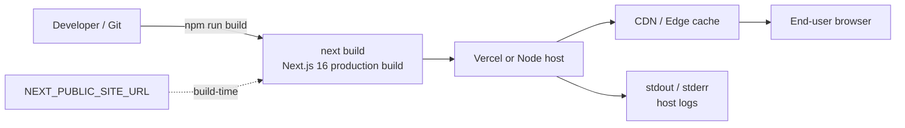

# Deployment Architecture Diagram

## Target Topology (per README)

The README documents Vercel as the deployment target (`npx vercel`) and describes the site as "fully static-friendly". No `vercel.json` or other infrastructure-as-code file exists in the repository, so the topology below is the intended shape rather than a verified configuration.

## Component Responsibilities

| Component | Role | Notes |
|-----------|------|-------|
| `npm run build` | Compiles the App Router tree, generates metadata routes and the OG image, type-checks | Requires native SWC bindings for Turbopack; Next suggests `next build --webpack` otherwise |
| Hosting platform | Serves the build output, serves static assets | No config file committed |
| CDN/Edge | Caches static HTML and assets | Implied by "static-friendly"; not verified |
| Host logs | Receives `console.log` contact enquiries | Contains PII; retention not defined |
| `NEXT_PUBLIC_SITE_URL` | Inlined at build time into metadata/sitemap/robots/manifest | Public value; not a secret |

## What Is NOT Part of the Topology

- No database, cache, queue, or object storage.
- No container image or Kubernetes manifests.
- No CI/CD pipeline definition in the repository.

See `docs/14-deployment-and-infrastructure.md` for the operational checklist.