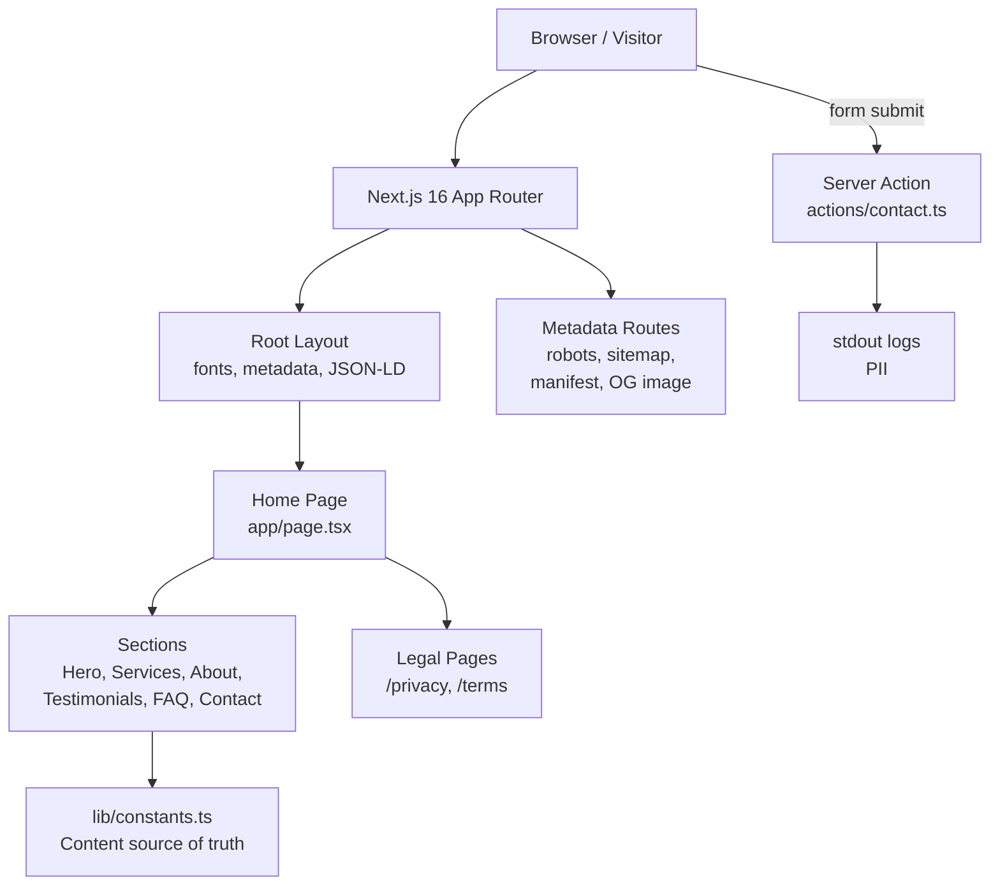
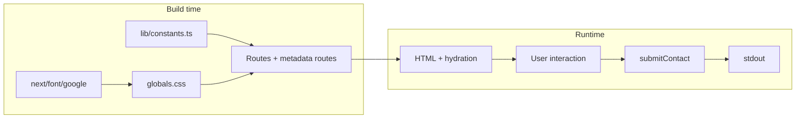

# System Architecture Diagram

## Layered View

## Runtime vs Build Time

## Notes

- Everything except the contact form is static content rendered from `lib/constants.ts`.
- The only dynamic server-side path is `submitContact`, which validates and logs.
- No database, cache, queue, or third-party API is involved at runtime.
- See `docs/04-system-architecture.md` for the full written analysis.